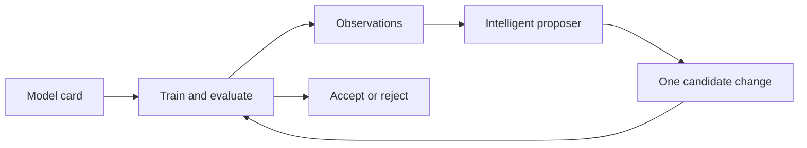

# Improve models with evidence, not guesswork

SIAI is a small Python framework for **budgeted, auditable model-improvement
experiments**. It connects trainer feedback to an intelligent proposer, tests one
change at a time, and keeps the change only when the model-card reward improves.



## Why SIAI?

- **Trainer-independent.** Keep one proposal contract while connecting different
  training libraries and feedback systems.
- **Evidence-grounded.** Every proposal cites observations produced by the
  current experiment.
- **Controlled.** A proposal changes one allowlisted lever, within a fixed
  evaluation budget, and must pass machine-enforced metric guardrails.
- **Auditable.** Candidate fingerprints, lineage, scores, failures, and decisions
  are written to an append-only JSONL journal.

## Installation

SIAI requires Python 3.11 or newer.

```bash
pip install siai
```

The package currently has no required runtime dependencies. Trainer integrations
such as TRL and Unsloth are optional and must be installed in their supported
environments.

!!! note "Development status"
    SIAI 0.1.0 is a prototype. The contracts, local experiment runner, and full
    trainer-to-proposer workflow, optional OpenAI Responses adapter, and real
    TRL/Unsloth compatibility runs are implemented. A live credentialed provider
    run and equal-budget proposer benchmarks remain milestones. No benchmark
    superiority is claimed.

## A complete first experiment

The evaluator and proposer are ordinary callables. The evaluator returns a finite
score to maximize; return a negative loss when your metric is minimized.

```python
from siai import Candidate, Experiment


def evaluate(config, seed, split):
    # Replace this with training plus validation on your task.
    target = 2.0
    return -(config["weight"] - target) ** 2


def propose(incumbent, history):
    next_weight = incumbent.config["weight"] + 0.5
    return Candidate(
        {"weight": next_weight},
        hypothesis="Move the weight toward the observed optimum",
    )


result = Experiment(
    evaluate,
    propose,
    budget=15,
    seeds=(0, 1, 2),
    journal="run.jsonl",
).run(Candidate({"weight": 0.0}))

print(result.best.config)
print(result.score)
```

This loop evaluates each candidate with the same seeds, preserves the incumbent
when a proposal is worse, and stops before exceeding its budget.

[Start the tutorial](getting-started.md){ .md-button .md-button--primary }
[Read the API reference](reference/core.md){ .md-button }

## What SIAI does not hide

Your application owns the trainer, task scorer, data splits, model provider, and
artifact storage. This is deliberate: a self-improvement claim is only meaningful
when the metric and evaluation boundary remain visible and reproducible.
