# SIAI technical report

**Engineering snapshot:** November 18, 2026  
**Target release:** v0.1.0  
**Repository:** [penguinkang/siai](https://github.com/penguinkang/siai)

## Executive summary

SIAI is an open-source Python framework for budgeted, auditable model-improvement
experiments. It connects a trainer-independent evidence contract to an
intelligent proposer, evaluates one controlled configuration change at a time,
and promotes the change only when the primary model-card reward improves and all
machine-enforced guardrails pass.

The current implementation includes the local experiment kernel, the full
trainer-to-proposer workflow, compact evidence context, strict structured
provider output, TRL and Unsloth adapters, named metric guardrails, documentation,
packaging, and continuous integration. Development-only branches contain four
end-to-end micro projects, real TRL and Unsloth runs, and an equal-budget proposer
benchmark harness.

The project is an engineering proof of concept. It does not yet establish that
an LLM proposer outperforms random or scripted search. It also does not claim
recursive self-improvement, statistical significance, secure execution of
untrusted code, or generalization beyond the measured tasks.

## Problem and contribution

Model-training systems expose different trainers, evaluators, logging formats,
and checkpoint mechanisms. A proposer tied directly to one trainer is difficult
to reuse and difficult to evaluate fairly. SIAI separates these concerns through
four contracts:

1. A `ModelCard` fixes the objective, primary metric, direction, allowed levers,
   free-text constraints, and executable metric guardrails.
2. A trainer returns `TrainingResult`: finite reward, named metrics,
   observations, and a checkpoint reference.
3. A proposer receives `ProposalRequest` and returns one evidence-cited
   `Proposal` that replaces one allowlisted top-level configuration value.
4. `ImprovementLoop` owns budget accounting, paired-seed evaluation, selection,
   lineage, failure handling, and journaling.

This positions SIAI as a portable evidence and interoperability layer for model
improvement. Training, model serving, task scoring, provider credentials, and
artifact storage remain application responsibilities.

## System architecture



The design keeps model providers and training libraries outside the core. The
core operates on JSON-serializable configurations and small immutable data
contracts. Heavy training dependencies load only when an adapter creates a
trainer.

| Component | Responsibility | Replaceable boundary |
| --- | --- | --- |
| `ModelCard` | Declares optimization intent and promotion guardrails | Application-defined |
| `ImprovementLoop` | Runs paired trials, applies budgets, selects, and records | Stable orchestration API |
| `SFTAdapter` | Converts TRL/Unsloth state into the shared result contract | Custom trainers can implement the same method |
| `IntelligentProposer` | Builds compact evidence context and validates one proposal | Any `generate(prompt) -> JSON text` callable |
| `OpenAIResponsesGenerator` | Requests strict structured output and captures call metadata | Other provider adapters can implement the callable |
| JSONL journal | Records configs, lineage, scores, metrics, proposals, failures, and checkpoints | External stores can consume the records |

Editable diagram source:

- [`siai-architecture.mmd`](assets/siai-architecture.mmd)
- [`siai-workflow-lucid.mmd`](assets/siai-workflow-lucid.mmd)

## Improvement workflow



The search workflow never consumes final-test results. It performs these steps:

1. Validate the model card, seeds, evaluation budget, and baseline configuration.
2. Train the baseline from a fresh state for every paired seed.
3. Aggregate the primary reward and named metrics; persist the complete trial.
4. Rank current evidence and compress history into tested configurations,
   directional gains, failures, metric outcomes, and guardrail status.
5. Call the provider once and validate the strict proposal contract.
6. Train the proposed configuration from the same fresh initial state and seeds.
7. Promote only when the primary metric improves by `min_gain` and every
   guardrail passes. Otherwise retain the incumbent and feed the rejected
   attempt's evidence into the next decision.
8. Stop before a complete paired-seed group would exceed the budget.
9. Return the selected configuration. The application may then evaluate its
   checkpoint once on an isolated final split.

### Lucidchart workflow source

[Lucidchart supports Mermaid through **Diagram as code**](https://help.lucid.co/hc/en-us/articles/29549366940948-Diagram-as-code-with-Mermaid-in-Lucidchart).
Open that tool, create a new Mermaid diagram, and paste the contents of
`docs/assets/siai-workflow-lucid.mmd`. The source uses basic flowchart syntax for
compatibility with Lucidchart's Mermaid implementation.

## Core data contracts

### Model card and guardrails

`ModelCard` names one primary metric with `maximize` or `minimize` direction.
Each `MetricGuardrail` declares a finite inclusive threshold using `at_least` or
`at_most`. Guardrail metrics must have unique names. A trainer must report every
required metric for every seed; missing or non-finite values make the evaluation
invalid.

Guardrails solve a narrow but important problem: a higher primary reward should
not be promoted when latency, validity, cost, or another declared success metric
crosses an unacceptable boundary. The current workflow applies thresholds to the
paired-seed mean. It does not yet estimate uncertainty.

### Evidence and decision context

`Observation` carries a stable ID, kind, measured summary, optional finite value,
and optional opaque artifact reference. SIAI never dereferences artifact content.

Before a model call, `build_proposal_context`:

- prioritizes failures, primary metrics, slices, and training signals;
- limits current observations to a configurable maximum, 64 by default;
- preserves every evaluated configuration so the model can avoid repeats;
- reduces journal rows to lever outcomes and direction-normalized gains; and
- carries named metrics, guardrail violations, remaining budget, and acceptance
  decisions.

The full immutable request remains available to the caller. Context selection
changes provider input size without changing `ProposalRequest -> Proposal`.

### Proposal validation

One model call must return exactly: `lever`, `value`, `hypothesis`,
`evidence_ids`, `expected_effect`, and `verification`. SIAI rejects malformed
JSON, unrecognized levers, invented evidence IDs, empty reasoning fields,
exhausted budgets, and configurations already evaluated.

Lever descriptions guide the model; trainer adapters enforce actual value types
and ranges before expensive work begins.

### Evaluation and journaling

An evaluation is one candidate/seed pair. Failed attempts consume budget.
Incomplete seed groups never launch. A baseline failure aborts because there is
no valid incumbent; later failures are recorded and rejected.

The append-only JSONL journal includes candidate fingerprints, parents,
configurations, hypotheses, provider metadata, per-seed scores, paired means,
named metrics, guardrail results, observations, checkpoints, errors, acceptance,
and cumulative evaluation counts.

## Integrations

### Training backends

| Backend | Implemented path | Validation evidence | Limitation |
| --- | --- | --- | --- |
| TRL | `SFTTrainer`, full fine-tuning | Real local tiny-model workflow | CUDA and distributed training unvalidated |
| Unsloth | `FastLanguageModel`, LoRA, MLX trainer | Real SmolLM2-135M Apple Silicon workflow | Not compute-equivalent to TRL; CUDA unvalidated |

Both paths use `SFTAdapter`, validate `learning_rate` and `warmup_ratio`, extract
supported training diagnostics, save checkpoints, and support a custom primary
scorer plus named metric scorer. The Unsloth MLX trainer does not expose TRL's
public `evaluate()` method, so its example computes held-out cross-entropy from
the model and tokenizer through the injected scorer.

### Provider integration

`OpenAIResponsesGenerator` uses the Responses API with a strict JSON schema,
`store=False`, configurable output limits, and provider metadata capture. The SDK
dependency is optional and lazily imported. Injected transports validate request
shape without credentials. A live credentialed benchmark remains pending.

## Validation evidence

| Evidence | Current result |
| --- | --- |
| Unit tests | 22 passing tests covering the core, proposer, provider, trainer, workflow, failures, directions, and guardrails |
| Documentation | Strict MkDocs Material build passes |
| Packaging | Wheel and source distribution build; release wheel contains no example projects |
| Continuous integration | GitHub Actions passes on `master` with Python 3.11 |
| TRL workflow | Baseline reward -1.8226; proposed reward -1.6575; proposal accepted; checkpoint reloaded |
| Unsloth workflow | Baseline reward -5.9500; proposed reward -5.4912; proposal accepted; final reward -5.4063 |
| Guardrails | Both real trainer examples report held-out loss as a named metric and pass the declared threshold |

The measured trainer examples use deterministic offline proposal fixtures. They
validate wiring and compatibility, not intelligent proposal discovery.

## Equal-budget proposer benchmark

The development branch contains a benchmark comparing random search, a fixed
script, a model with raw history, and the same model with compact SIAI context.
Its protocol uses three task families, three independent runs, paired seeds,
eight logical training evaluations per run, and one isolated final evaluation.

The committed run uses a deterministic offline model fixture. Raw and compact
model strategies therefore follow identical reward trajectories by construction.
Compact prompts use 74,538 characters compared with 81,696 for raw history, an
8.8% reduction. Random search leads some toy-task averages. These results validate
the harness and context ablation; they provide no evidence of LLM superiority.

| Task | Random mean search gain | Scripted/model-fixture gain | Interpretation |
| --- | ---: | ---: | --- |
| Decision tree | 0.249 | 0.228 | Random reached stronger depths in these three runs |
| PyTorch MLP | 0.187 | 0.160 | Random sampled stronger learning rates |
| Inference threshold | 0.033 | 0.047 | Scripted and fixture strategies reached the best search threshold |

Research-grade claims require live providers, independently repeated searches,
multiple model versions, token and monetary cost, confidence intervals, and
larger task suites.

## Repository and release structure

`master` contains only the release library, tests, documentation, and CI.
`dev/micro-projects` contains sample projects, larger dependency environments,
measured outputs, and benchmark artifacts. No `examples/` paths are present in
the release branch or wheel.

This separation lets the project retain reproducible engineering evidence
without publishing toy datasets, model weights, or large trainer dependencies as
runtime package content.

## Security and reproducibility boundaries

Trainer and evaluator callbacks execute with the host process's permissions.
Prompt instructions are not a sandbox, and SIAI v0.1.0 must not execute untrusted
generated code. Final-test credentials must stay outside the proposer process.

Candidate fingerprints cover JSON configuration content. They do not yet bind
model weights, datasets, evaluator code, package versions, or environment state.
The journal is useful audit evidence but is not tamper-proof provenance.

## Known limitations

- The intelligent proposer makes one provider call and cannot abstain.
- Lever ranking is model-generated; there is no calibrated gain estimator.
- Promotion uses paired means without confidence intervals or significance tests.
- There is no resume, concurrent writer support, timeout, resource isolation, or
  crash-atomic checkpoint manifest.
- The OpenAI path has fixture-level integration coverage but no committed live
  provider result.
- Trainer validation covers local TRL and Apple Silicon Unsloth MLX paths; CUDA,
  multi-GPU, and remote execution remain unvalidated.
- Current benchmark tasks are small and do not support effectiveness claims.

## Recommended next milestones

1. Add artifact manifests binding configuration, checkpoint digest, code commit,
   evaluator version, data split digest, packages, hardware, and provider model.
2. Add paired uncertainty estimates and a configurable promotion policy.
3. Run the benchmark with a live provider across pinned model versions and
   independent search repetitions; publish negative results.
4. Add process-isolated runners with time, memory, and device limits.
5. Implement a final-report protocol that consumes the selected checkpoint
   without exposing final metrics to the search loop.
6. Freeze release dependencies, add a changelog, tag v0.1.0, and publish only
   after the release checklist passes.

## Reproduction commands

```bash
PYTHONPATH=src .venv/bin/python -m unittest discover -s tests -v
.venv/bin/mkdocs build --strict
uv build
```

Development-only trainer and benchmark commands are documented on the
`dev/micro-projects` branch.
